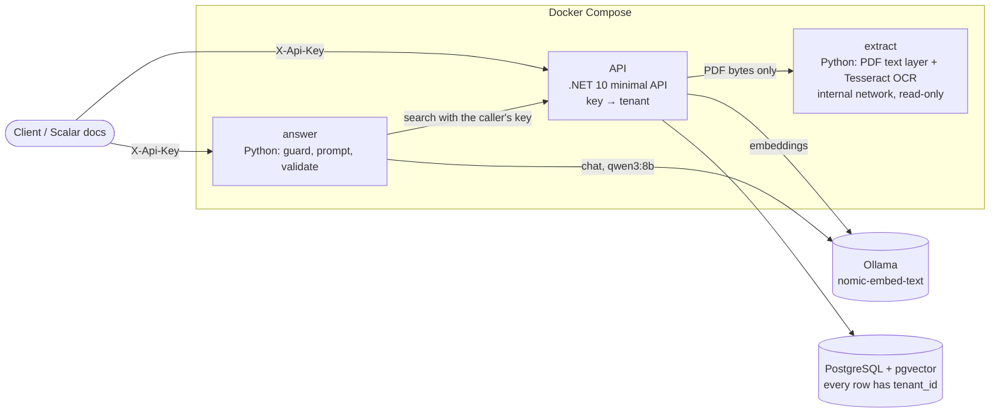
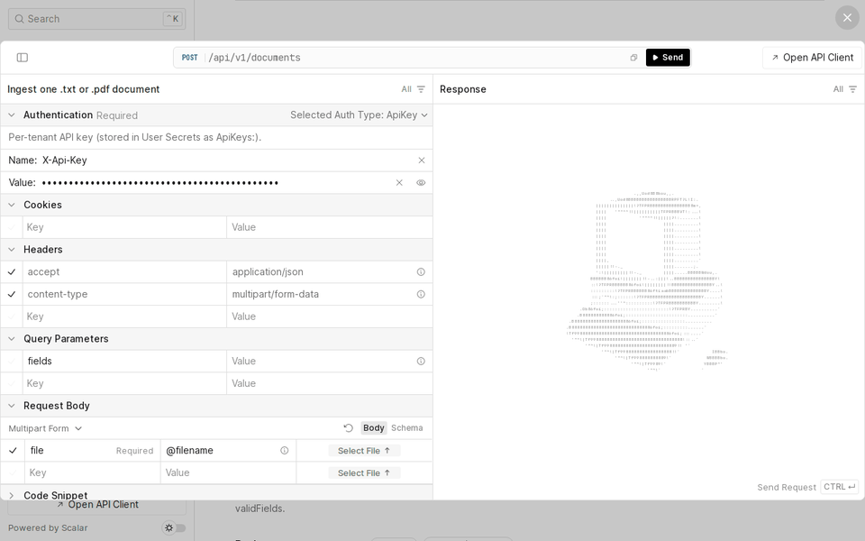
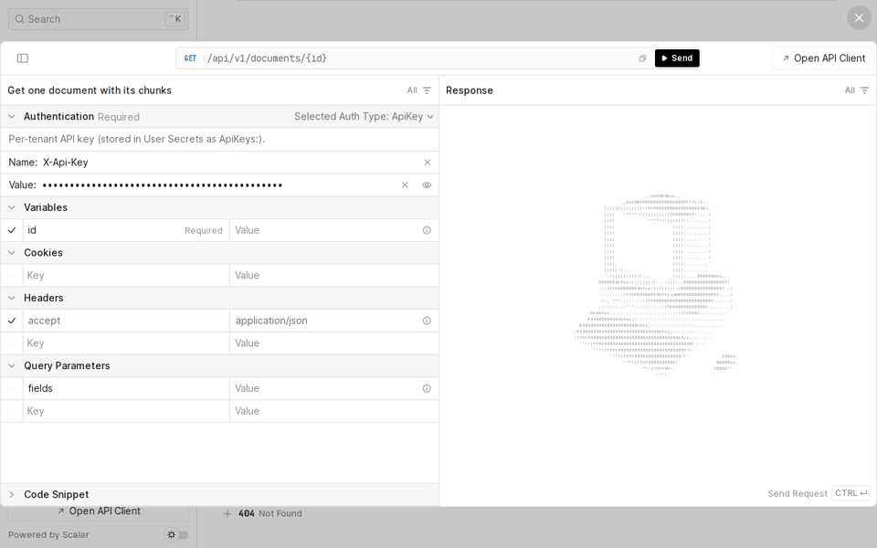
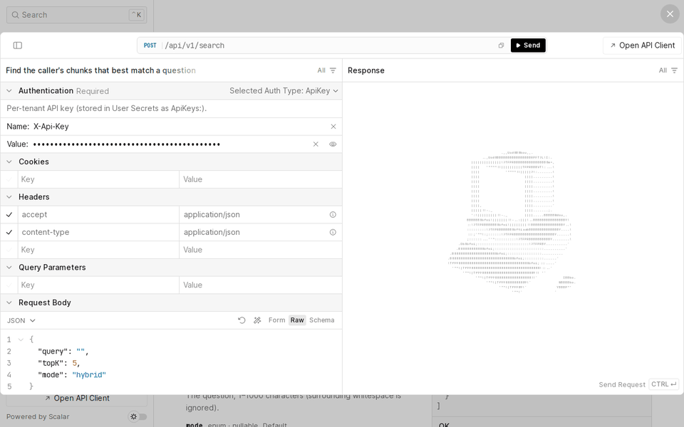

# FreightRAG

A learning project: a **multi-tenant RAG** (retrieval-augmented generation) system for logistics documents
(rate confirmations, bills of lading, invoices). Everything runs locally in Docker.

## What it does

- **Ingests** text files and **scanned PDFs** (OCR), splitting them by section and embedding them with a local model.
- **Searches** by meaning and by keyword (hybrid search, fused with RRF), always scoped to the tenant that owns the API key.
- **Extracts key/value fields** (load number, rates, detention terms…) from a document, on upload or on get-by-id, with an
  option to ask for only some fields.
- **Answers questions with citations** from a local model, and abstains when the documents don't say.
- **Measures itself**: retrieval recall/MRR, answer fact checks, an abstention table and a calibrated faithfulness judge.

| Area | Result | Details |
|---|---|---|
| Answers on unanswerable questions | 0 of 8 answered (false answers) | `docs/articles/answer-evaluation.md` |
| Field extraction | 94% on clean PDFs, 87% on scans (52 fields) | `docs/articles/document-fields.md` |
| Retry/rewrite idea | tested, did not help, not adopted | `docs/articles/answer-retry-experiment.md` |

## Architecture



- **Upload:** the API checks the key, hands a PDF to `extract` (text layer, or OCR for scans), chunks the text by section,
  embeds the chunks with Ollama and stores them in one transaction. Duplicates are skipped before the costly embedding call.
- **Ask:** `answer` calls the API's search with the caller's own key (so it only ever sees that tenant's chunks), refuses
  early if the question names an identifier no retrieved chunk contains, asks the model for a cited JSON answer, and checks
  the citations in code.
- **Code layout (DDD):** `FreightRag.Core` holds the domain, the use cases and the adapters; the API and the console ingester
  are thin hosts. Details: `docs/articles/architecture.md`.

## Demo

Recorded from the interactive API docs (Scalar, <http://localhost:8080/scalar/v1>). The page already holds a public
learning-project test key, shown masked.

**Upload a scanned PDF.** The service reads it with OCR and returns the extraction report and the fields it found, such as the load number, rates and detention terms.



**Get one document, asking only for some fields** with `?fields=loadNumber,lineHaul,totalAgreedRate`.



**Hybrid search** (vector + keyword, fused with RRF), scoped to the tenant that owns the key.



The GIFs are recorded by `docs/demo/make_gifs.py`.

## How to run it

Everything runs in Docker; no .NET SDK or Python is needed on your machine. The numbered sections below explain each step in detail.

1. **Start the two backing containers** (a Postgres 17 + pgvector 0.8 container `freightrag-db` on `localhost:55432`, and
   Ollama `freightrag-ollama` on `localhost:11434`), then pull the models once (about 5.5 GB):
   ```bash
   docker exec freightrag-ollama ollama pull nomic-embed-text
   docker exec freightrag-ollama ollama pull qwen3:8b
   ```
2. **Store the secrets** (database password and one API key per tenant) in .NET User Secrets: section 1.
3. **Create the schema:**
   ```bash
   docker compose run --build --rm migrate
   ```
4. **Load the sample documents:** section 4.
5. **Start the services:**
   ```bash
   docker compose up -d --build extract api answer
   ```
6. **Try it:**
   - Interactive docs: <http://localhost:8080/scalar/v1> (the learning-project test key is prefilled; see `docs/articles/getting-started.md`)
   - Ask a question:
     ```bash
     curl -H "X-Api-Key: $KEY" -H "Content-Type: application/json" \
          -d '{"question":"What is the detention rate for load 48213?"}' http://localhost:8090/api/v1/answer
     ```
7. **Run the tests:** section 3.

## Prerequisites

Everything runs in Docker — **no .NET SDK is needed on your machine**.

- Docker Desktop (or Docker Engine with Compose v2)
- Postgres 17 + pgvector 0.8 on `localhost:55432` (container `freightrag-db`), database `freightrag`,
  user `freightrag`. The schema is **code-first**: EF Core migrations create and upgrade it (step 2 below);
  applications never migrate at startup.
- Ollama on `localhost:11434` (container `freightrag-ollama`) with the embedding model pulled:
  ```bash
  docker exec freightrag-ollama ollama pull nomic-embed-text
  ```

The app container reaches both through `host.docker.internal` (see `src/FreightRag.Ingest/appsettings.json`).

## 1. Store the database password (User Secrets)

The password is read **only** from .NET User Secrets (key `Database:Password`). It is never in
`appsettings.json`, environment variables, command-line arguments or the image. The `user-secrets`
compose service runs the `dotnet user-secrets` tool from the SDK image; only this project's secrets
folder is mounted into it.

Create this project's secrets folder (private to you) so Docker doesn't create it:

```bash
mkdir -p -m 700 ~/.microsoft/usersecrets/bc38a00e-bd57-4c78-9333-1f52ff1438ed
```

Type the password without echo (it is not saved in shell history):

```bash
read -rs PW
```

Send it on **stdin** as JSON, so it never appears in `ps` or `docker inspect` (if the password contains
`"` or `\`, escape them as `\"` and `\\`):

```bash
printf '{"Database:Password":"%s"}' "$PW" | docker compose --profile tools run --rm -T user-secrets set && unset PW
```

The same command with a placeholder password, to see the shape:

```bash
printf '{"Database:Password":"%s"}' 'change-me' | docker compose --profile tools run --rm -T user-secrets set
```

With a local .NET 10 SDK the equivalent is
`dotnet user-secrets set "Database:Password" "change-me" --project src/FreightRag.Ingest`.

### API keys (only for the HTTP API)

One key per tenant, at least 32 characters. This prints each key once; store them in your password manager:

```bash
for t in tenant-nile-freight tenant-delta-haul; do KEY="$(openssl rand -base64 32)"; printf '{"ApiKeys:%s":"%s"}' "$t" "$KEY" | docker compose --profile tools run --rm -T user-secrets set; echo "$t: $KEY"; done
```

`user-secrets set` merges, so this keeps the stored password. Run it again to rotate the keys.

## 2. Create or upgrade the schema (EF Core migrations)

```bash
docker compose run --build --rm migrate
```

Safe to repeat. A database created earlier by `db/001_schema.sql` is adopted automatically, and existing chunks are
backfilled with the configured embedding model (`Ollama:EmbeddingModel`). See `docs/articles/database.md`.

## 3. Run the tests

```bash
docker compose run --build --rm tests
```

Unit and in-memory API tests — no database or Ollama needed. They use the real files in `data/`.

```bash
docker compose run --build --rm integration-tests
```

Integration tests against a **throwaway** pgvector database (`testdb`, same image digest, data in memory) on an
internal Docker network `freightrag-net`, using hand-made vectors: tenant isolation, overfiltering / iterative
scans, model isolation, migrations. Your real database is not touched. Clean up afterwards with
`docker compose --profile integration down`.

## 4. Ingest the documents

```bash
docker compose run --build --rm ingest
```

`data/` is mounted read-only at `/data`. Running it a second time skips every file (same tenant +
same SHA-256 = already ingested). Outside Docker (with a local SDK and `localhost` in appsettings) the
equivalent is `dotnet run --project src/FreightRag.Ingest -- --data-dir data`.

Exit codes: `0` success · `1` some files failed (or an unexpected error) · `2` bad arguments/configuration · `130` cancelled (Ctrl+C).

## 5. Run the HTTP API

```bash
docker compose up --build api
```

- Interactive docs (Scalar): <http://localhost:8080/scalar/v1> — click *Authorize* and paste a tenant key
- OpenAPI document: <http://localhost:8080/openapi/v1.json>
- Health: <http://localhost:8080/health/live>, <http://localhost:8080/health/ready>

```bash
curl -H "X-Api-Key: $KEY" -F "file=@data/tenant-nile-freight/invoice-NFL-2026-1187.txt;type=text/plain" http://localhost:8080/api/v1/documents
```

A PDF works the same way, including **scanned PDFs** (read with OCR by the separate `extract` service; start it with
`docker compose up -d --build extract api`). The response then carries an extraction report (pages, OCR confidence, warnings):

```bash
curl -H "X-Api-Key: $KEY" -F "file=@rate-confirmation-48213.pdf;type=application/pdf" http://localhost:8080/api/v1/documents
```

How it works and its limits: `docs/articles/pdf-ingestion.md`.

The upload result (and `GET /api/v1/documents/{id}`) also carries the **fields** read from the document, such as the carrier name,
load number and totals; add `?fields=carrierName,loadNumber` to pick some. They are read by rules and not stored:
`docs/articles/document-fields.md`.

Search (ranked chunks only; answers come from the separate answer service, section 8):

```bash
curl -H "X-Api-Key: $KEY" -H "Content-Type: application/json" -d '{"query":"detention rate for load 48213","topK":3}' http://localhost:8080/api/v1/search
```

The tenant comes from the key — never from the URL or body — so another tenant's document id answers `404` and its
chunks never appear in your search results. The query text is never logged.

## 6. Browse the documentation site

```bash
docker compose up --build docs
```

Open <http://localhost:8081>: guide articles, the interactive REST API reference and the C# reference
generated from the XML comments (DocFX). CI builds the same site on every PR and can deploy it to GitHub
Pages (see `deploy-docs` in `.github/workflows/ci.yml` for the one-time setup).

If you change the API or add a migration, regenerate the committed snapshots (`docs/openapi/v1.json`,
`db/00x_*.sql`) — a test fails until you do:

```bash
docker run --rm --user "$(id -u):$(id -g)" -e HOME=/tmp -e UPDATE_OPENAPI_SNAPSHOT=1 -e UPDATE_DB_SCRIPTS=1 -v "$PWD":/repo -w /repo mcr.microsoft.com/dotnet/sdk:10.0.403-noble@sha256:212fe4cb74627d5adf9817a4088906ae3edff1bd853bb27565d4b46731efe61e dotnet test --project src/FreightRag.Tests/FreightRag.Tests.csproj
```

It runs as your own user (so `bin/`/`obj/` aren't left owned by root on Linux) and bind-mounts the repo,
so the regenerated files land in your working tree — commit them with the change.

## 7. Measure retrieval quality

```bash
docker compose --profile eval run --build --rm retrieval-eval
docker compose --profile eval run --rm retrieval-eval --compare
```

A Python evaluation (`evals/`) asks 45 questions (8 of them unanswerable) with known correct chunks and reports
**recall@k** and **MRR**, checking tenant isolation on every result. `--mode vector|keyword|hybrid` evaluates one
retrieval mode; `--compare` runs all three side by side. Setup (API keys via environment variables) and how to read the numbers:
`evals/README.md`.

To judge the answers rather than the retrieval, see section 8's answer evaluation:
`docker compose --profile eval run --rm answer-eval generate`, then `judge` on the saved file (fact checks, an
abstention table and DeepEval faithfulness with a local judge); `calibrate` checks the judge against hand-labelled
cases first. Details: `docs/articles/answer-evaluation.md`.

## 8. Ask a question (the answer service)

The answer service (`answer/`, Python) retrieves chunks through the search API and has a local model answer **only from
them, with citations**, or abstain. It needs the model pulled into your Ollama container once (about 5 GB):

```bash
docker exec freightrag-ollama ollama pull qwen3:8b
docker compose up -d --build answer
```

```bash
KEY='<your tenant key>'
curl -H "X-Api-Key: $KEY" -H "Content-Type: application/json" \
     -d '{"question":"What is the detention rate for load 48213?"}' http://localhost:8090/api/v1/answer
```

The reply is `{ "status": "answered" | "insufficient_context", "answer", "citations" }`. A question about an
identifier that no retrieved chunk contains (say load 48999) is answered `insufficient_context` **without calling the
model**. Details, and what is checked in code: `docs/articles/answer-service.md` and `answer/README.md`.

## How it works

### Solution layout (DDD inside three projects)

| Project | Role |
|---|---|
| `FreightRag.Core` | `Domain/` pure business model · `Application/` use case + ports (interfaces) · `Infrastructure/` Postgres and Ollama adapters |
| `FreightRag.Ingest` | Console app: composition root, folder walking, summary |
| `FreightRag.Api` | ASP.NET Core minimal API: API-key auth (key → tenant), documents + search endpoints, OpenAPI + Scalar, rate limiting |
| `FreightRag.Migrator` | Applies the EF Core migrations (`docker compose run --rm migrate`) |
| `FreightRag.IntegrationTests` | Real-pgvector tests (search, isolation, migrations) |
| `FreightRag.Tests` | xUnit v3 tests, written test-first; `ArchitectureTests` enforce Domain → nothing, Application → Domain only |

Domain model: `FreightDocument` (aggregate root) owns its `DocumentChunk`s; value objects `TenantId`,
`SourceHash`, `DocType`, `DocumentIdentifiers`, `EmbeddingVector`, `EmbeddingModelName`, `SearchText`, `TopK`;
domain service `SectionChunker`. Persistence is EF Core (code-first) with records kept in Infrastructure.
The use case `IngestDocumentHandler` talks to the outside world only through
`IDocumentRepository`, `IEmbeddingService` and `ITenantDirectory`; reads go through `IDocumentQueries`.
The console app and the API call the same use case.

### Chunking

- A **section** starts at an ALL-CAPS line (`RATE`, `PICKUP`) or a numbered caps heading
  (`3. DETENTION REPORTING`). A heading must be ≤ 80 chars, mostly letters and not end with `.`, so a
  code such as `SAV-778431` or a shouted sentence is not a heading.
- **No text is ever dropped.** In a run of consecutive ALL-CAPS lines only the first is the heading and
  the rest are body (so `SHIPPER` / `BAYOU FROZEN FOODS` / `1500 CLINTON DR` stays together), and a
  heading with no body (a document title) becomes a chunk containing its own text. A test checks that
  every line of every real document ends up in some chunk.
- A section body over ~1,000 characters is split on paragraph (blank-line) boundaries, then on line
  boundaries. A line is never cut.
- Every chunk starts with a **context header**, e.g.
  `Document: rate-confirmation | Load: 48213 | Section: RATE`.
  Embedded together with the text, it lets a question like *"detention for load 48213"* find the right
  chunk even though the RATE section itself never mentions the load number.

### Embedding

`nomic-embed-text` expects a task prefix: chunks are sent as `search_document: <content>` (queries will
use `search_query: `). The prefix is not stored. All chunks of a document go in one batch call, and any
vector that is not exactly 768-dimensional stops that file with a clear error.

### Retrieval

`POST /api/v1/search` is **hybrid** by default: in one transaction it runs a **vector leg** (the question embedded
with the same model as the chunks, prefix `search_query: `, nearest chunks by cosine distance, with
`SET LOCAL hnsw.iterative_scan = strict_order` so filtering by tenant and model can't starve small tenants of results)
and a **keyword leg** (PostgreSQL full-text search over a generated `content_tsv` column with a GIN index, any of the
question's words, ranked by `ts_rank_cd`). Each leg returns up to `Search:CandidateCount` (default 20) candidates; **Reciprocal Rank Fusion** merges
them by rank and the top k are returned with `vectorRank`, `keywordRank`, `fusedScore` and the cosine `distance`.
`"mode": "vector" | "keyword"` runs one leg only. No relevance threshold yet. Details: `docs/articles/retrieval.md`
and `docs/articles/hybrid-search.md`.

### Storage and idempotency

`source_hash` is the SHA-256 of the file's raw bytes. If `(tenant_id, source_hash)` exists the file is
skipped before calling the model. Otherwise the document row and all chunk rows are inserted in **one
transaction** (`ON CONFLICT DO NOTHING` also covers two runs racing). All SQL is parameterized.

## Security notes

- **Tenant isolation is enforced by application code** (`tenant_id` on every row). The future query
  side must always filter by `tenant_id`; consider Postgres Row-Level Security as a second line of defence.
- User Secrets are **plain-text JSON** in `~/.microsoft/usersecrets/` — fine for local development, not
  for production (use a secret manager / vault there).
- Logs show `host:port/db as user`, never the password, connection string or API keys.
- API keys are kept only as SHA-256 hashes in memory and compared in constant time; the API port is
  bound to `127.0.0.1` because keys travel over plain HTTP. Uploads are rate-limited per tenant.
- `.env` is git-ignored **and** docker-ignored, so it can never end up in an image layer.
- The ingest container runs as the non-root `app` user, with data and **only this project's** secrets
  folder mounted read-only.
- Symbolic links inside `data/` are rejected (a link could smuggle another tenant's file in under the
  wrong `tenant_id`), and files are read with a hard 10 MB limit.
- Traffic to Postgres/Ollama is unencrypted, acceptable only because both are bound to `127.0.0.1`.
  For anything non-local, require TLS (`SSL Mode=VerifyFull`) and put Ollama behind authentication.

## Pinned versions

Images: `mcr.microsoft.com/dotnet/sdk:10.0.403-noble`, `mcr.microsoft.com/dotnet/runtime:10.0.14-noble`
(pinned by digest in `Dockerfile`/`compose.yaml`). Packages: `src/Directory.Packages.props`; Python (`evals/`,
`answer/`): `pyproject.toml` and `uv.lock`.
Rule: stable releases only, published at least two weeks before adoption.
